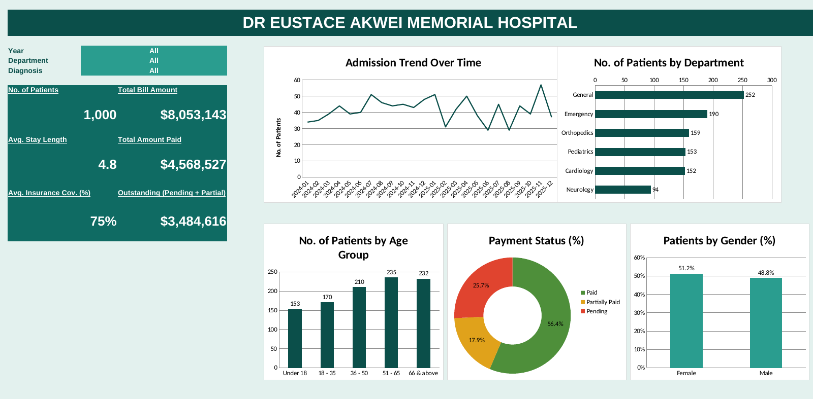

# DR-EUSTACE-AKWEI-MEMORIAL-HOSPITAL-PERFORMANCE-DASHBOARD

### A Data Analysis Project On Patient Admissions, Billing And Insurance Coverage, Built In Microsoft Excel.

## Introduction

Hospitals generate large amounts of data every day, yet management often lacks a single view of how the hospital is performing. This project turns the hospital's patient records into an interactive Excel dashboard that answers practical questions such as how many patients are being treated, which departments are busy, how much is being billed, how much is still unpaid, and where management should focus.
The analysis covers 1,000 patient visits across six departments. It combines operational measures (patient volume, length of stay, age profile) with financial measures (bills, payments, insurance coverage) so that decisions can be based on evidence.

## About the Dataset
The dataset contains one row per patient visit, so a patient who visited more than once appears in more than one row. It has 1,000 records and 11 fields. Admission dates run from January 2024 to December 2025, and discharges extend to early January 2026. Patient ages range from 1 to 85 years. A check of the data found no missing values, no duplicate Patient IDs and no discharge date earlier than its admission date.
### Fields added during analysis
 - **Length of Stay**: discharge date minus admission date, in days.
 - **Age Group**: Under 18, 18 - 35, 36 - 50, 51 - 65 and 66 & above.
 - **Admission Year and Month**: used for the trend analysis.
 - **Outstanding Amount**: the full bill value of visits whose status is Pending or Partially Paid. The dataset has no "amount paid" field, so partially paid  bills   are   counted in full and outstanding is an upper estimate.

## Problem Statement

Management has noticed changes in patient admissions, outstanding medical bills and insurance coverage across departments. The hospital has no consolidated report that gives a clear picture of its operational and financial performance. The task was to analyse the patient data and build an interactive dashboard that helps management monitor performance and make informed decisions.
### Questions the analysis answers
 1. **How many patient visits has the hospital recorded**?
 2. **Which departments receive the highest number of patients**?
 3. **Which departments generate the highest total bills**?
 4. **What is the average length of stay across departments**?
 5. **What proportion of bills is paid, pending or partially paid**?
 6. **How much has been billed and how much remains outstanding**?
 7. **How does insurance coverage vary across departments and diagnoses**?
 8. **Which age groups account for the most visits**?
 9. **How do admissions and billing change over time**?
 10. **Which areas may require management attention**?

## Visualization

**The dashboard was built in Excel. The tiles on the left show the headline figures, and the Year, Department and Diagnosis dropdowns filter every tile and chart at once.**

## Insights

  **Patient volume**:
The hospital recorded 1,000 patient visits. General has the most (252), followed by Emergency (190), Orthopedics (159), Pediatrics (153) and Cardiology (152). Neurology is the smallest at 94. Women account for 51.2% of visits and men for 48.8%.

 **Billing and length of stay by department**:
The hospital billed $8,053,143 in total, an average of $8,053 per visit. Volume and revenue do not line up: General and Emergency see the most patients but bill little per visit, while Orthopedics, Cardiology and Neurology bill several times more per visit. Orthopedics, Cardiology and Neurology together produce about 73% of all billing from about 40% of the visits

 The average length of stay is 4.8 days. Orthopedics is longest at 8.4 days, and 66 of its 159 stays (about 42%) lasted 10 days or more. Emergency is shortest at   2 days.

 **Payment status**:
564 visits (56.4%) are fully paid, 257 (25.7%) are pending and 179 (17.9%) are partially paid. By value, $4,568,527 has been paid and about $3,484,616 (43.3% of billing) is outstanding: $2,082,786 pending and $1,401,830 partially paid. The General department has the highest unsettled share, with about half of its billed value outstanding.
   
 **Insurance coverage**:
Average coverage is 74.9%. Department averages are very close (74% to 76%), so coverage differences come from diagnosis rather than department. Coronary Artery Disease (82.9%) and RSV (80.8%) are covered best. Asthma (61.5%), Arrhythmia (63.5%) and Epilepsy (67.9%) are covered least among diagnoses with at least 10 visits. 44 visits ($345,195) had no insurance cover at all, and 32 of them are still not fully paid.

 **Age groups**:
Patients aged 51 to 65 make the most visits (235), closely followed by those aged 66 and above (232). Together these two groups are about 47% of all visits, and the 51 to 65 group also has the highest average bill ($10,028). Under 18s account for 153 visits at a much lower average bill.

 **Admissions and billing over time**:
Admissions were steady across the two years (508 in 2024 and 492 in 2025). Billing fell about 5%, from $4,132,465 to $3,920,678. Billing is lowest in the first quarter of 2024 ($843,958) and peaks in the fourth quarter of each year ($1,135,111 in 2024 and $1,121,184 in 2025). Monthly admissions are volatile, with a high of 57 in November 2025 and a low of 29 in June 2025.

## Recommendations

   **Target Orthopedics collections**: Orthopedics has the largest outstanding balance ($1,095,631). Confirm insurance and payment arrangements before admission and settle bills at discharge.

  **Strengthen collection in the General department**: About 49.6% of its billed value is unsettled, the highest of any department. Assign follow-up staff and reminders for pending accounts.

  **Prioritise high-value unsettled bills**: 35 bills of $20,000 or more, worth $892,390, are not fully paid. Recovering these first has the greatest financial effect.

  **Support uninsured and low-coverage patients**: Offer financial counselling and payment plans for the 44 uninsured visits, and review billing for low-coverage diagnoses such as Asthma and Arrhythmia.

  **Review long stays**: Orthopedics, Neurology and Cardiology have the longest stays. A review of care pathways and discharge planning could free beds and lower costs.

  **Plan for demand**: Billing peaks in the fourth quarter and the 51 and over age groups make up nearly half of visits. Use this to plan staffing, beds and supplies.

  **Improve data capture**: Record the amount actually paid, payment dates and a unique patient identifier. This would give exact outstanding balances, show how overdue bills are, and reveal repeat patients.

## Conclusion

The hospital handled 1,000 patient visits and billed $8,053,143, but about 43% of that value is still unsettled. Orthopedics, Cardiology and Neurology drive the revenue and the longest stays, while General and Emergency carry the volume. Insurance coverage varies more by diagnosis than by department, and a small group of uninsured or high-value accounts holds a large share of the unpaid money.
The dashboard gives management one place to monitor these measures and filter by year, department and diagnosis. Acting on the recommendations above, particularly on collections in Orthopedics and General, should improve cash flow without affecting patient care.
**Tools used**: Microsoft Excel (formulas, dropdown filters and charts).

